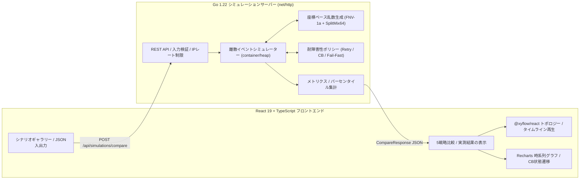

# FailureLab — 分散システムの障害・耐障害性シミュレーター

[](https://github.com/Takafumi122/failure-simulator/actions)
-00ADD8)


**FailureLab** は、分散マイクロサービスの障害を再現する、対話型かつ決定論的な**離散イベントシミュレーター（Discrete-Event Simulator：DES）**です。

下流サービスの遅延・停止・確率的エラーが、ワーカープールの枯渇やキューの飽和を通じて上流に連鎖する様子をモデル化します。同じトラフィック条件と乱数シードの下で、**5種類の耐障害性戦略**（`Baseline`、`Retry`、`Circuit Breaker`、`Retry + Circuit Breaker`、`Fail-Fast`）を比較できます。

---

## デモ・スクリーンショット

- **公開デモURL**：`https://<your-deployment-domain>.onrender.com`（公開後に実際のURLへ置き換えてください）
  - `Dockerfile`、`render.yaml`、`fly.toml` を用意しており、デプロイ可能な構成です。
- **スクリーンショット・GIF**（画像の作成・追加後に掲載してください）：
  - `docs/images/scenario-gallery-comparison.png` — 5戦略の比較表と実測結果に基づく分析
  - `docs/images/topology-timeline-replay.gif` — 障害の連鎖とCircuit Breakerの状態遷移を時系列で再生する様子

---

## 開発の背景と目的

実際のマイクロサービス環境では、**Retry（リトライ）**や**Circuit Breaker（サーキットブレーカー）**などの耐障害性対策が、定量的な検証ではなく経験則によって設定されることがあります。しかし、障害の種類によっては、安易なリトライが**Retry Storm（リトライストーム）**を引き起こし、上流サービスのワーカープールを圧迫して、応答時間の悪化を招きます。

FailureLabは、こうした分散システムの振る舞いを**ブラウザ上で可視化・再現・定量評価**するために開発しました。

1. **障害の連鎖を可視化**：末端のデータストア（`Feature DB`）で発生した遅延が、同期呼び出しを行う `Recommendation` → `Product API` → `API Gateway` へ伝播し、ワーカープールやFIFOキューが飽和する様子を観察できます。
2. **耐障害性戦略のトレードオフを定量評価**：論理リクエストの成功率、p50/p95/p99レイテンシ（成功・失敗別の集計を含む）、呼び出し増幅率、Circuit Breakerの拒否件数・状態遷移などを、5戦略で比較できます。
3. **決定論的な再現性**：実験設定をJSON形式でエクスポート・インポートできます。同じパラメータと乱数シードで実行すると、メトリクスとイベント履歴が一致します。

---

## システム構成

Go標準ライブラリを中心とするシミュレーションサーバーと、React・TypeScript・`@xyflow/react`・Rechartsを利用したシングルページアプリケーションで構成しています。



### 固定された5ノードのサービス構成

`Client` → `API Gateway` → `Product API` → `Recommendation` → `Feature DB`

| サービス | 役割 | 基本処理時間 | 最大同時実行ワーカー数 | キュー上限 | デフォルトタイムアウト |
|---|---|---:|---:|---:|---:|
| `client` | リクエスト流入の生成 | 0 ms | 無制限 | 0 | 1500 ms |
| `api-gateway` | ルーティング・認証 | 10 ms | 50 | 100 | 1200 ms |
| `product-api` | 商品カタログの情報集約 | 20 ms | 35 | 70 | 900 ms |
| `recommendation` | レコメンド処理 | 35 ms | 25 | 50 | 650 ms |
| `feature-db` | 低遅延の特徴量ストア | 15 ms | 20 | 40 | 450 ms |

---

## シミュレーションモデル

### 離散イベントシミュレーション（`container/heap`）

実際のHTTPサーバーを複数起動したり、`time.Sleep` で待機したりする代わりに、イベントキューからイベントを取り出して**仮想時間**（`TimestampMs`）を進めます。[`internal/engine/queue.go`](backend/internal/engine/queue.go) では、最小ヒープでイベントを `(TimestampMs, SequenceID)` の昇順に処理します。

- **`REQUEST_ARRIVAL`**：リクエストの試行（Attempt）がサービスに到着します。`activeWorkers < maxConcurrent` なら即座にワーカーを確保して `PROCESSING_START` へ進みます。それ以外の場合、`len(waitQueue) < queueLimit` ならFIFOキューに入ります（`QUEUE_ENQUEUED`）。キューが満杯の場合は `queue_overflow` として即時に失敗します。
- **`PROCESSING_START`**：障害注入（`none`、`outage`、`latency`、`error_rate`）を評価し、サービス内の処理を下流呼び出し前（60%）と呼び出し後（40%）に分けます。
- **`DOWNSTREAM_CALL` / `RETRY_BACKOFF_COMPLETE`**：有効な [`resilience.Policy`](backend/internal/resilience/policy.go) を参照します。下流応答やリトライ待機中も、**上流の呼び出し元はワーカー枠を保持**します。これにより、同期ブロッキングRPCの振る舞いをモデル化しています。
- **`PROCESSING_COMPLETE` / `REQUEST_FAILURE` / `REQUEST_TIMEOUT`**：ワーカー枠を解放し、FIFOキューの次のリクエストを処理します。Circuit Breakerのカウンターを更新し、必要に応じてリトライを予約するか、結果を親スパンへ伝播します。
- **`CIRCUIT_STATE_CHANGE`**：`CLOSED`、`OPEN`、`HALF_OPEN` 間の状態遷移を、仮想時刻とともに記録します。

---

## 耐障害性戦略

5戦略すべてを、同じリクエスト到着スケジュールと障害発生期間で実行します。対策を適用する呼び出し境界のデフォルトは `recommendation -> feature-db` です。

### 1. `baseline` — 対策なし

RetryやCircuit Breakerを利用せず、デフォルトのサービスタイムアウトで1回だけ呼び出します。

### 2. `retry` — リトライ（指数バックオフ + Equal Jitter）

`fault_error`、`fault_outage`、`queue_overflow`、`timeout` をリトライ可能なエラーとして扱い、最大 `maxRetries` 回（デフォルト `3` 回）まで再試行します。

試行 $k+1$ の前に待機する時間は、次の式で計算します。

$$
\text{backoff} = \min\left(\text{MaxBackoffMs},\ \text{InitialBackoffMs} \times \text{Multiplier}^{k-1}\right) \times (0.5 + 0.5u)
$$

ここで $u \in [0, 1)$ は、座標ベースの決定論的乱数から生成します。また、呼び出し元の残り期限を守り、`now + backoff >= caller.DeadlineMs` となる場合は再試行しません。

### 3. `circuit_breaker` — サーキットブレーカー

- **`CLOSED`**：連続失敗回数を記録します。`consecutiveFailures >= consecutiveFailuresThreshold`（デフォルト `5`）に達すると `OPEN` に遷移します。
- **`OPEN`**：下流サービスを呼び出さず、`circuit_open`（リトライ不可）として即時に拒否します。`openTimeoutMs`（デフォルト `3000ms`）経過後に `HALF_OPEN` へ遷移します。
- **`HALF_OPEN`**：最大 `halfOpenMaxCalls` 件（デフォルト `2`）の試験的な呼び出しを同時に許可します。`halfOpenSuccessThreshold` 回（デフォルト `2`）連続成功すると `CLOSED` に戻り、試験呼び出しが失敗すると即座に `OPEN` へ戻ります。

### 4. `retry_circuit_breaker` — Retry + Circuit Breaker

一時的な失敗には指数バックオフ付きRetryで対応し、Circuit Breakerが `OPEN` の間は追加のリトライを即座に抑止します。

### 5. `fail_fast` — Fail-Fast（試行単位のタイムアウト短縮）

対象の呼び出し境界におけるAttempt単位のタイムアウトを、通常の `450ms` から `120ms` や `90ms` などに短縮します。下流が遅延しているときに、ブロックされた上流ワーカーを早く解放することが目的です。

---

## 実験結果（エンジン `v3.0.0-des` の計測値）

以下は、FailureLabのシナリオギャラリーに用意された実験条件で得られた決定論的な計測結果です。数値は元のREADMEに記載されたものをそのまま掲載しています。

### 1. 一時的障害（`transient-failure`）

`feature-db` に35%の確率的エラーを注入（`t = 6s..18s`、35 RPS、Seed 42）

| 戦略 | 論理リクエスト成功率 | エラー率 | p95レイテンシ | 対象DB呼び出し数 | Retry回数（増幅率） | CB拒否数 |
|---|---:|---:|---:|---:|---:|---:|
| **Baseline** | 82.5% | 17.5% | 84.1 ms | 875 | 0（1.00倍） | 0 |
| **Retry** | **98.9%（+16.4ポイント）** | **1.1%** | 162.7 ms | 1,113 | 238（1.27倍） | 0 |
| **Circuit Breaker** | 79.3% | 20.7% | 83.9 ms | 833 | 0（1.00倍） | 42 |
| **Retry + CB** | **91.9%（+9.4ポイント）** | 8.1% | 146.4 ms | 1,037 | 222（1.27倍） | 60 |
| **Fail-Fast** | 82.5% | 17.5% | 84.1 ms | 875 | 0（1.00倍） | 0 |

### 2. 長時間停止（`prolonged-outage`）

`feature-db` を完全停止（`t = 4s..20s`、40 RPS、Seed 42）

| 戦略 | 論理リクエスト成功率 | 対象DB呼び出し数 | Retry回数（増幅率） | CB拒否数 | 観察結果 |
|---|---:|---:|---:|---:|---|
| **Baseline** | 33.3% | 960 | 0（1.00倍） | 0 | 16秒間の停止中に到着したリクエストはすべて失敗 |
| **Retry** | 34.2% | **2,876** | **1,916（3.00倍）** | 0 | 成功率はほぼ変わらず、下流負荷は約3倍に増加 |
| **Circuit Breaker** | 33.3% | **355（−605）** | 0（1.00倍） | **605** | 停止期間中の無駄な呼び出しを約94%削減 |
| **Retry + CB** | 33.4% | **359（−601）** | **4（1.01倍）** | **605** | Breakerの`OPEN`によってRetry Stormを抑制 |

### 3. Retry Storm（`retry-storm`）

`feature-db` に220msの追加遅延を注入（`t = 5s..17s`、50 RPS、Seed 101）

| 戦略 | 論理リクエスト成功率 | 全体p95 | 失敗リクエストp95 | 対象DB呼び出し数 | DBキュー最大長 | Timeout数 |
|---|---:|---:|---:|---:|---:|---:|
| **Baseline** | 50.1% | 202.4 ms | 202.8 ms | 1,200 | 0 | 599 |
| **Retry** | 53.3% | **870.0 ms** | **870.0 ms** | **2,936** | **22** | **2,299** |
| **Circuit Breaker** | 50.1% | 189.2 ms | 198.8 ms | 656 | 0 | 55 |
| **Fail-Fast（90ms）** | 50.1% | **132.4 ms** | **132.8 ms** | 1,200 | 0 | 599 |

---

## 技術的な設計判断

### 1. なぜ実際のコンテナやスレッドではなく、離散イベントシミュレーション（DES）を採用したのか

- **高速性と再現性**：50 RPS・30秒間のトラフィックをシミュレートすると、1,500リクエスト × 4サービス × 5戦略を扱います。約120,000イベントの処理を、OSのスケジューリングや`time.Sleep`の時間誤差に左右されることなく、単一のGo goroutineで**実時間40ms未満**で実行できます（元READMEに記載された計測値）。
- **安全性と移植性**：外部データベースやDocker-in-Dockerの権限が不要なステートレス構成で、公開ポートフォリオとして安全に動かしやすい設計です。

### 2. なぜ座標ベース乱数（`(seed, reqID, serviceID, attempt, purpose)`）を採用したのか

一般的な逐次型の疑似乱数生成器（`rand.Rand`）では、ある戦略がリクエスト#12でRetryを追加すると、その分だけ乱数が消費されます。すると、次のリクエスト#13の到着ジッターや障害判定に使われる乱数がBaselineと異なり、公平な比較ができなくなります。

FailureLabでは、`(seed, reqID, serviceID, attempt, purpose)` を **FNV-1a + SplitMix64** でハッシュする仕組み（[`internal/engine/rng.go`](backend/internal/engine/rng.go)）を採用しました。これにより、同一リクエスト・同一試行に対応する到着時刻、レイテンシジッター、障害判定用の乱数が5戦略間で揃います。これは**共通乱数法（Common Random Numbers）**を用いた比較のばらつき低減にもつながります。

### 3. Retry StormとCircuit Breakerのトレードオフ

- **Retry**：相関の低い一時的なエラーに対する成功率向上と引き換えに、下流への呼び出し負荷や上流ワーカーの拘束時間が増加します。DBの完全停止や過負荷のような相関のある障害では、リトライがキュー長とタイムアウトを増幅させる可能性があります。
- **Circuit Breaker（Fallbackなし）**：下流が完全停止している状況で成功リクエストを生み出すものではありません。`circuit_open` によって拒否された呼び出しは、依然として失敗です。主な役割は**リソース保護と早期の障害分離**であり、障害中の依存先への不要な呼び出しを抑え、Retryの増幅を防ぎ、上流ワーカーを早く解放することです。

---

## 現在の制約

1. **同期的な直列依存モデル**：Phase 1〜3では、固定された5ノードの直列依存のみを扱います。非同期メッセージキューやキャッシュによるFallbackはモデル化していません。
2. **タイムアウト後も継続する下流処理（Orphaned Work）**：呼び出し元やAttemptがタイムアウトしても、すでに開始された下流処理は、ローカル処理が完了するまでワーカーを占有します。これは、クライアント側のタイムアウトが実行中のHTTP/SQL処理を即座に停止するとは限らない振る舞いを表現したものです。遅れて返されたレスポンスは `ActiveChildSpanID` と `Span.Completed` のガードによって無視し、二重完了やワーカーの二重解放を防ぎます。
3. **公開環境の安全上限**：APIには `durationSec <= 300`、`requestsPerSecond <= 500`、`maxRetries <= 10`、`maxEvents <= 500,000`、JSONリクエストボディ `64 KB` の制限とIP単位のトークンバケット型レート制限を設けています。`maxEvents`に達すると `executionMeta.truncated = true` となり、未完了リクエストを失敗として計上します。

---

## ローカルでの起動方法

### 動作要件

- **Go**：1.22以上
- **Node.js**：20以上 / npm

### 1. Goバックエンドを起動

```bash
cd backend
go run ./cmd/server
# http://localhost:8080 で待ち受け（PORT環境変数で変更可能）
```

### 2. React + Viteフロントエンドを起動

```bash
cd frontend
npm install
npm run dev
# http://localhost:5173 を開く（/api は http://localhost:8080 にプロキシ）
```

### 3. 単一バイナリ / Dockerによる本番相当の起動

`STATIC_DIR`を設定すると、Goサーバーからビルド済みフロントエンドを直接配信できます。

```bash
docker build -t failurelab .
docker run --rm -p 8080:8080 failurelab
# http://localhost:8080 を開く（ヘルスチェック: http://localhost:8080/healthz）
```

---

## テスト

### バックエンド：ユニットテスト・不変条件検証・レース検出

```bash
cd backend
go vet ./...
go test -v -race ./...
```

### フロントエンド：型チェック・本番ビルド・Playwright E2E

```bash
cd frontend
npm run build
npm run test:e2e
```

---

## ライセンス

本プロジェクトは [MIT License](LICENSE) の条件に従って公開しています。
