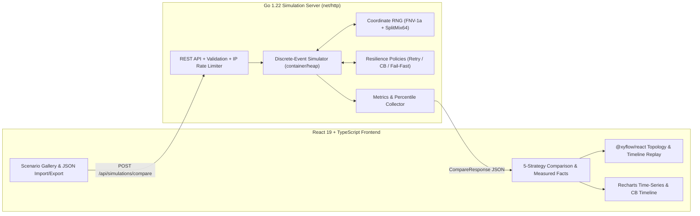

# FailureLab — Distributed Systems Failure & Resilience Simulator

[](https://github.com/takafumi/system_observation/actions)
-00ADD8)


**FailureLab** is an interactive, deterministic **Discrete-Event Simulator (DES)** for distributed microservice architectures. It models how downstream latency spikes, outages, and probabilistic errors cascade upstream through worker pool exhaustion and queue saturation—and lets engineers compare **5 resilience strategies** (`Baseline`, `Retry`, `Circuit Breaker`, `Retry + Circuit Breaker`, and `Fail-Fast`) side-by-side under identical traffic and random seeds.

---

## Live Demo & Screenshots

- **Live Demo URL**: `https://<your-deployment-domain>.onrender.com` *(Deploy ready via included [`Dockerfile`](Dockerfile), [`render.yaml`](render.yaml), and [`fly.toml`](fly.toml))*
- **Screenshots / GIF**:
  > *(Add portfolio screenshots or screen-recording GIFs here)*
  > - `docs/images/scenario-gallery-comparison.png` — 5-Strategy Comparison Table & Measured Observations
  > - `docs/images/topology-timeline-replay.gif` — Real-time Cascading Failure & Circuit Breaker State Replay

---

## Why FailureLab? (Project Purpose)

In production microservice systems, resilience patterns like **Retry** and **Circuit Breaker** are often configured by intuition rather than quantitative verification. Under certain failure modes, naive retries amplify load into a **Retry Storm**, exhausting upstream thread pools and worsening tail latency.

FailureLab was built to make these distributed systems dynamics **visible, reproducible, and measurable in milliseconds** inside a browser:
1. **Visualize Cascading Failures**: Watch how a slowdown at a leaf datastore (`Feature DB`) blocks synchronous callers (`Recommendation` $\rightarrow$ `Product API` $\rightarrow$ `API Gateway`), saturating bounded worker pools and FIFO wait queues.
2. **Quantify Resilience Trade-offs**: Compare logical request success rate, p50/p95/p99 latency (split by success vs. failure), call amplification factor, Circuit Breaker rejections, and state transitions across 5 strategies simultaneously.
3. **100% Deterministic Reproducibility**: Export and import simulation configurations as JSON. Every run with the same seed and parameters produces bit-for-bit identical metrics and event traces.

---

## Architecture

FailureLab consists of a zero-dependency Go standard-library simulation server and a React + TypeScript + `@xyflow/react` + Recharts single-page application.



### Fixed 5-Node Service Topology
`Client` $\rightarrow$ `API Gateway` $\rightarrow$ `Product API` $\rightarrow$ `Recommendation` $\rightarrow$ `Feature DB`

| Service Node | Role | Default Base Latency | Max Concurrent Workers | Queue Limit | Default Timeout |
|---|---|---|---|---|---|
| `client` | Ingress Traffic Generator | 0 ms | Unlimited | 0 | 1500 ms |
| `api-gateway` | Edge Routing & Auth | 10 ms | 50 | 100 | 1200 ms |
| `product-api` | Core Catalog Aggregator | 20 ms | 35 | 70 | 900 ms |
| `recommendation` | Personalization Engine | 35 ms | 25 | 50 | 650 ms |
| `feature-db` | Low-Latency Feature Store | 15 ms | 20 | 40 | 450 ms |

---

## Simulation Model

### Discrete-Event Simulation (`container/heap`)
Instead of spawning real HTTP servers or calling `time.Sleep`, FailureLab advances virtual time (`TimestampMs`) by popping events from a min-heap priority queue ([`internal/engine/queue.go`](backend/internal/engine/queue.go)) ordered by `(TimestampMs, SequenceID)`:
- `REQUEST_ARRIVAL`: A request attempt arrives at a service. If `activeWorkers < maxConcurrent`, it acquires a worker immediately (`PROCESSING_START`). Otherwise, if `len(waitQueue) < queueLimit`, it enters the FIFO queue (`QUEUE_ENQUEUED`); if the queue is full, it fails immediately with `queue_overflow`.
- `PROCESSING_START`: Evaluates fault injection (`none`, `outage`, `latency`, `error_rate`) and splits local service work into pre-downstream work (60%) and post-downstream work (40%).
- `DOWNSTREAM_CALL` & `RETRY_BACKOFF_COMPLETE`: Consults the active [`resilience.Policy`](backend/internal/resilience/policy.go). While waiting for a downstream response or retry backoff, **the upstream caller continues holding its worker slot**, faithfully modeling synchronous blocking RPCs.
- `PROCESSING_COMPLETE` / `REQUEST_FAILURE` / `REQUEST_TIMEOUT`: Releases the service worker, drains the next waiting request from the FIFO queue, updates Circuit Breaker counters, and either schedules a retry or propagates the outcome to the parent span.
- `CIRCUIT_STATE_CHANGE`: Records exact virtual-time transitions between `CLOSED`, `OPEN`, and `HALF_OPEN`.

---

## Resilience Strategies

All 5 strategies are executed against the exact same request arrival schedule and fault window (applied by default to the `recommendation -> feature-db` call boundary):

1. **`baseline` — Baseline (No Retry / No Circuit Breaker)**
   - Single attempt per service call using default service timeouts.
2. **`retry` — Retry (Exponential Backoff + Equal Jitter)**
   - Retries retryable failures (`fault_error`, `fault_outage`, `queue_overflow`, `timeout`) up to `maxRetries` (default `3`).
   - Backoff duration before attempt $k+1$:
     $$\text{backoff} = \min\left(\text{MaxBackoffMs},\ \text{InitialBackoffMs} \times \text{Multiplier}^{k-1}\right) \times (0.5 + 0.5 u)$$
     where $u \in [0, 1)$ is drawn deterministically from the Coordinate RNG.
   - Respects the caller's remaining deadline: if `now + backoff >= caller.DeadlineMs`, no retry is scheduled.
3. **`circuit_breaker` — Circuit Breaker (Closed / Open / Half-Open)**
   - **`CLOSED`**: Tracks consecutive failures. Trips to `OPEN` when `consecutiveFailures >= consecutiveFailuresThreshold` (default `5`).
   - **`OPEN`**: Immediately rejects calls with `circuit_open` (non-retryable) without touching the downstream service. Transitions to `HALF_OPEN` after `openTimeoutMs` (default `3000ms`).
   - **`HALF_OPEN`**: Permits up to `halfOpenMaxCalls` (default `2`) concurrent probe requests. Closes the circuit after `halfOpenSuccessThreshold` (default `2`) consecutive successes, or re-opens immediately on any probe failure.
4. **`retry_circuit_breaker` — Retry + Circuit Breaker**
   - Combines exponential-backoff retries for transient blips with a Circuit Breaker that halts retries immediately whenever the circuit is `OPEN`.
5. **`fail_fast` — Fail-Fast (Short Per-Attempt Timeout)**
   - Overrides the per-attempt timeout on the target call edge (e.g., `120ms` or `90ms` instead of `450ms`), releasing blocked upstream workers quickly during latency spikes.

---

## Experiment Results (Measured from Engine `v3.0.0-des`)

Below are actual deterministic measurements produced by FailureLab across the 5 Scenario Gallery presets:

### 1. Transient Failure (`transient-failure`: 35% Error Rate on `feature-db`, `t = 6s..18s`, 35 RPS, Seed 42)
| Strategy | Logical Success Rate | Error Rate | p95 Latency (ms) | Target DB Calls | Retries (Amp) | CB Rejections |
|---|---:|---:|---:|---:|---:|---:|
| **Baseline** | 82.5% | 17.5% | 84.1 ms | 875 | 0 (1.00x) | 0 |
| **Retry** | **98.9%** (+16.4%) | **1.1%** | 162.7 ms | 1,113 | 238 (1.27x) | 0 |
| **Circuit Breaker** | 79.3% | 20.7% | 83.9 ms | 833 | 0 (1.00x) | 42 |
| **Retry + CB** | **91.9%** (+9.4%) | 8.1% | 146.4 ms | 1,037 | 222 (1.27x) | 60 |
| **Fail-Fast** | 82.5% | 17.5% | 84.1 ms | 875 | 0 (1.00x) | 0 |

### 2. Prolonged Outage (`prolonged-outage`: 100% Outage on `feature-db`, `t = 4s..20s`, 40 RPS, Seed 42)
| Strategy | Logical Success Rate | Target DB Calls | Retries (Amp) | CB Rejections | Key Takeaway |
|---|---:|---:|---:|---:|---|
| **Baseline** | 33.3% | 960 | 0 (1.00x) | 0 | Fails every request during the 16s blackout |
| **Retry** | 34.2% | **2,876** | **1,916 (3.00x)** | 0 | Triples downstream load with near-zero benefit |
| **Circuit Breaker** | 33.3% | **355** (-605) | 0 (1.00x) | **605** | Sheds 94% of futile calls during blackout |
| **Retry + CB** | 33.4% | **359** (-601) | **4 (1.01x)** | **605** | Breaker OPEN prevents the 1,916-call retry storm |

### 3. Retry Storm (`retry-storm`: +220ms Latency on `feature-db`, `t = 5s..17s`, 50 RPS, Seed 101)
| Strategy | Logical Success Rate | Overall p95 | Failed Req p95 | Target DB Calls | Peak DB Queue | Timeouts |
|---|---:|---:|---:|---:|---:|---:|
| **Baseline** | 50.1% | 202.4 ms | 202.8 ms | 1,200 | 0 | 599 |
| **Retry** | 53.3% | **870.0 ms** | **870.0 ms** | **2,936** | **22** | **2,299** |
| **Circuit Breaker** | 50.1% | 189.2 ms | 198.8 ms | 656 | 0 | 55 |
| **Fail-Fast (90ms)** | 50.1% | **132.4 ms** | **132.8 ms** | 1,200 | 0 | 599 |

---

## Technical Decisions

### 1. Why Discrete-Event Simulation (DES) Instead of Real Containers/Threads?
- **Speed & Determinism**: Simulating 30 seconds of 50 RPS traffic (1,500 requests $\times$ 4 services $\times$ 5 strategies $\approx$ 120,000 events) takes **< 40ms of wall-clock CPU time** in a single Go goroutine without OS scheduling noise or `time.Sleep` drift.
- **Safety & Portability**: Runs statelessly with zero external databases or Docker-in-Docker privileges, making it safe to expose publicly as an interactive web portfolio.

### 2. Why Coordinate RNG (`(seed, reqID, serviceID, attempt, purpose)`)?
- In a standard sequential PRNG (`rand.Rand`), as soon as Strategy B performs a retry on Request #12, it consumes extra random numbers. Request #13 then receives different random values for its arrival jitter and fault evaluation than it did in Strategy A (`Baseline`), invalidating a fair comparison.
- By hashing `(seed, reqID, serviceID, attempt, purpose)` via **FNV-1a + SplitMix64** ([`internal/engine/rng.go`](backend/internal/engine/rng.go)), Request #k Attempt #1 sees the **exact same arrival timestamp, latency jitter, and fault roll across all 5 strategies** (Common Random Numbers variance reduction).

### 3. Trade-off Between Retry Storms and Circuit Breakers
- **Retries** trade *extra downstream load and upstream worker hold time* for *higher success rates on uncorrelated transient errors*. When failures are correlated (e.g., a database outage or saturation), retries amplify queue lengths and cause cascading timeouts.
- **Circuit Breakers (without a fallback cache)** do *not* magically turn failed requests into successes during a total downstream outage—requests rejected with `circuit_open` still fail. Instead, a Circuit Breaker's primary value is **resource protection and fail-fast isolation**: it stops hammering a struggling dependency, prevents retry amplification, and frees upstream workers immediately.

---

## Limitations

1. **Synchronous Linear Chain**: Phase 1–3 models a fixed 5-node serial dependency chain without asynchronous message queues or cache fallbacks.
2. **Orphaned Downstream Work on Timeout**: When an upstream caller or per-attempt timer times out, an already-started downstream attempt continues occupying its downstream worker until its local service time completes (modeling standard HTTP/SQL behavior where a client timeout does not instantaneously abort an in-flight database query). Late responses are safely ignored by `ActiveChildSpanID` and `Span.Completed` guards so double-completion or double-release never occurs.
3. **Safety Caps for Public Hosting**: Public API requests are bounded to `durationSec <= 300`, `requestsPerSecond <= 500`, `maxRetries <= 10`, `maxEvents <= 500,000`, `64 KB` JSON payload limit, and per-IP token-bucket rate limiting. If `maxEvents` is reached, `executionMeta.truncated = true` is set and unfinished requests are counted as failures.

---

## Local Development

### Prerequisites
- **Go**: 1.22+
- **Node.js**: 20+ / npm

### 1. Start the Go Simulation Backend
```bash
cd backend
go run ./cmd/server
# Listening on http://localhost:8080 (configurable via PORT env var)
```

### 2. Start the React + Vite Frontend
```bash
cd frontend
npm install
npm run dev
# Open http://localhost:5173 (proxies /api to http://localhost:8080)
```

### 3. Single-Binary / Docker Production Run
The Go server can serve the compiled frontend directly when `STATIC_DIR` is set:
```bash
docker build -t failurelab .
docker run --rm -p 8080:8080 failurelab
# Open http://localhost:8080 (Healthcheck at http://localhost:8080/healthz)
```

---

## Testing

### Backend Unit, Invariant & Race-Detector Tests
```bash
cd backend
go vet ./...
go test -v -race ./...
```

### Frontend Typecheck, Production Build & Playwright E2E Tests
```bash
cd frontend
npm run build
npm run test:e2e
```

---

## License

This project is licensed under the terms of the [MIT License](LICENSE).

