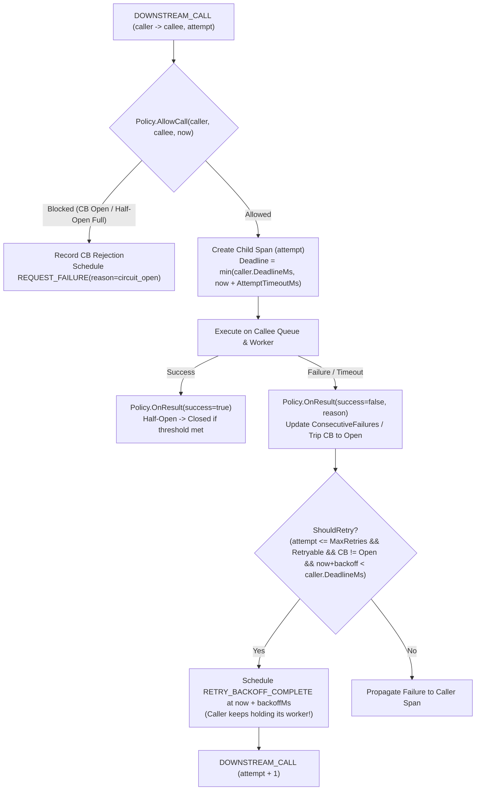

# FailureLab アーキテクチャ設計書 (Phase 1 & Phase 2)

## 1. パッケージ構成

```text
system_observation/
├── requirements.md              # 要件定義書 (Phase 1 & 2)
├── architecture.md              # アーキテクチャ設計書 (Phase 1 & 2)
├── tasks.md                     # 実装タスク一覧
├── README.md                    # 起動方法・アルゴリズム・前提と限界
├── backend/                     # Go バックエンド
│   ├── go.mod
│   ├── cmd/
│   │   └── server/
│   │       └── main.go          # エントリポイント・CORS・ルーティング
│   └── internal/
│       ├── model/
│       │   └── types.go         # 共通データ構造（Config, ResilienceConfig, Event, Metrics, BreakerTransition）
│       ├── topology/
│       │   └── topology.go      # 固定トポロジー定義・プリセットシナリオ（一時障害、長時間停止、Retry Storm等）
│       ├── fault/
│       │   └── injector.go      # 障害注入判定ロジック（停止・遅延・確率的失敗）
│       ├── resilience/
│       │   └── policy.go        # 5戦略（baseline, retry, circuit_breaker, retry_circuit_breaker, fail_fast）とCB状態機械
│       ├── metrics/
│       │   ├── collector.go     # 論理リクエスト/Attempt分離集計・Retry Amplification・CB拒否・時系列算出
│       │   └── percentile.go    # p50 / p95 / p99 計算ユーティリティ
│       ├── engine/
│       │   ├── queue.go         # container/heap を用いた優先度付きイベントキュー
│       │   ├── rng.go           # 戦略間で乱数消費が干渉しない座標ベース決定的乱数生成器 (Coordinate RNG)
│       │   ├── simulator.go     # 離散イベントシミュレーション (DES) コアエンジン
│       │   └── simulator_test.go# Phase 1 & Phase 2 (A〜I) 網羅ユニットテスト
│       └── api/
│           ├── handler.go       # GET /api/scenarios, POST /api/simulations/compare, バリデーション
│           ├── handler_test.go  # APIハンドラテスト
│           └── integration_test.go # 全シナリオ・5戦略比較E2Eテスト
└── frontend/                    # React + TypeScript + Vite フロントエンド
    └── src/
        ├── types/simulation.ts  # バックエンドAPIと一致する型定義
        ├── api/client.ts        # APIクライアント
        ├── App.tsx              # メイン画面・戦略切替・再生管理
        └── components/
            ├── ControlPanel.tsx       # シナリオ・障害・Retry・CB・FailFast・サービス容量設定
            ├── StrategyComparison.tsx # 5戦略の比較表（Baseline比デルタ表示）・比較バーチャート・CB状態遷移タイムライン
            ├── TopologyFlow.tsx       # @xyflow/react サービス依存図＆選択中戦略のリアルタイム再生
            ├── ServiceNode.tsx        # カスタムノード（CB状態バッジ・Retry/Queue/Worker表示）
            ├── PlaybackBar.tsx        # 時系列イベント再生バー
            ├── MetricsCards.tsx       # KPIカード
            ├── ChartsPanel.tsx        # 時系列グラフ（成功率、レイテンシ、キュー長）
            └── EventLogView.tsx       # サービス内訳＆戦略別イベントストリームログ
```

---

## 2. 決定論的座標乱数 (Coordinate RNG) の設計 (`internal/engine/rng.go`)

複数戦略（`baseline`, `retry`, `circuit_breaker`, `retry_circuit_breaker`, `fail_fast`）を比較する際、単一の `rand.Rand` ストリームを共有すると、ある戦略で Retry が発生した瞬間に乱数の消費位置がずれ、以降のリクエストの到着時刻や下流の確率的失敗判定が別戦略と異なってしまう（Common Random Numbers の崩壊）。

これを防ぐため、`(Seed, RequestID, ServiceID, Attempt, Purpose)` のタプルから FNV-1a / SplitMix64 ベースの決定論的ハッシュ関数を用いて $[0.0, 1.0)$ の一様乱数を直接生成する `DeterministicRNG` を実装する。

- **到着時刻ジッター**: `Float64(reqID, "client", 1, PurposeArrivalJitter)` → 全戦略でリクエスト `#k` の到着時刻が 100% 同一になる。
- **サービスローカル処理時間ジッター**: `Float64(reqID, serviceID, attempt, PurposeLatencyJitter)` → 同じ `(reqID, serviceID, attempt)` ならどの戦略でも同じ処理時間になる。
- **確率的障害判定**: `Float64(reqID, serviceID, attempt, PurposeFaultEval)` → 同じ `(reqID, serviceID, attempt)` ならどの戦略でも同じ成功/失敗判定になる。
- **Retry Backoff Jitter**: `Float64(reqID, serviceID, attempt, PurposeRetryJitter)` → 同じ Attempt のバックオフジッターが決定論的に定まる。

---

## 3. Retry / Circuit Breaker / Fail-Fast のイベント統合設計

### 3.1 呼び出し境界 (Call Edge) 単位の Policy 管理
`resilience.Policy` は呼び出し元 `callerID` と呼び出し先 `calleeID` の境界（例: `recommendation -> feature-db`）ごとに設定・状態を管理する。



### 3.2 Circuit Breaker 状態遷移ルール
呼び出し境界ごとに `EdgeBreaker` インスタンスを保持する：
- **`CLOSED`**:
  - `AllowCall`: 常に許可 (`true`)。
  - `OnResult(success=true)`: `consecutiveFailures = 0`。
  - `OnResult(success=false)`: `consecutiveFailures++`。もし `consecutiveFailures >= ConsecutiveFailuresThreshold` なら `OPEN` へ遷移し、`openedAtMs = now` を記録、状態遷移イベントを発行。
- **`OPEN`**:
  - `AllowCall`: `now - openedAtMs >= OpenTimeoutMs` であれば `HALF_OPEN` へ遷移（状態遷移イベントを発行）し、`halfOpenInFlight = 1`, `halfOpenSuccesses = 0` としてこの呼び出しを許可 (`true`)。
  - それ以外は拒否 (`false, ReasonCircuitOpen`)。
- **`HALF_OPEN`**:
  - `AllowCall`: `halfOpenInFlight < HalfOpenMaxCalls` であれば `halfOpenInFlight++` として許可 (`true`)。超えていれば拒否 (`false, ReasonCircuitOpen`)。
  - `OnResult(success=true)`: `halfOpenInFlight--`, `halfOpenSuccesses++`。もし `halfOpenSuccesses >= HalfOpenSuccessThreshold` なら `CLOSED` へ遷移（`consecutiveFailures = 0`、状態遷移イベントを発行）。
  - `OnResult(success=false)`: `halfOpenInFlight--`。即座に `OPEN` へ戻し、`openedAtMs = now` を更新（状態遷移イベントを発行）。

### 3.3 Attempt Timeout と Request Deadline の分離
- 各サービス設定 `ServiceConfig.TimeoutMs` はそのサービス自身のスパン全体のデッドライン（論理リクエスト期限）を規定する。
- `fail_fast` 戦略（または `ResilienceConfig.AttemptTimeoutMs`）が対象境界（`recommendation -> feature-db`）に適用された場合、子スパン（`feature-db` の各 Attempt）のデッドラインは `min(parentSpan.DeadlineMs, now + AttemptTimeoutMs)` となる。
- 1回目の Attempt が `AttemptTimeoutMs` でタイムアウトした際、親スパン（`recommendation`）の `DeadlineMs` がまだ残っていれば、Retry 戦略は2回目の Attempt を発行できる。
- 一方、タイムアウトした子スパンや親スパンに対して後から到着した完了イベントは、`Span.Completed == true` によって即座に無視（No-op）され、二重完了やワーカーの二重解放を起こさない。

---

## 4. メトリクス定義 (Step 5)

| メトリクス名 | JSONフィールド | 計算式・定義 |
|---|---|---|
| 論理リクエスト成功率 | `overall.successRate` | `overall.successCount / overall.totalRequests`（未完了・truncated分も分母に含める厳密計算） |
| 論理リクエストエラー率 | `overall.errorRate` | `overall.failureCount / overall.totalRequests` |
| End-to-End p50 / p95 / p99 | `overall.p50LatencyMs` 等 | 完了した論理リクエストのクライアント到着〜完了までの所要時間パーセンタイル |
| 総下流呼び出し数 | `overall.totalDownstreamCalls` | 全バックエンドサービスに対して実際に開始（到着）した総 Attempt 数 |
| Retry回数 | `overall.totalRetries` | `attempt > 1` として実行された追加 Attempt の総数 |
| Retry Amplification Factor | `overall.retryAmplificationFactor` | 対象境界（またはバックエンド全体）における `総Attempt数 / 初回Attempt数`（Retryなし時は `1.0`） |
| Circuit Breaker 拒否数 | `overall.circuitBreakerRejections` | CB が `OPEN`（または `HALF_OPEN` 上限）のため下流を呼ばずに即座に拒否された回数 |
| Timeout数 | `overall.timeoutCount` | 論理リクエストがタイムアウトで失敗した回数（サービス別では各サービスの Attempt タイムアウト数） |
| 最大Worker使用率 | `overall.maxWorkerUtilization` | 全サービス中の `peakConcurrent / maxConcurrent` の最大比率 (`0.0`〜`1.0`) |
| 最大Queue長 | `overall.maxQueueLength` | 全サービス中の `peakQueueLength` の最大値 |
| Breaker状態遷移一覧 | `breakerTransitions` | `[{ timestampMs, second, edge, fromState, toState, reason }]` |
